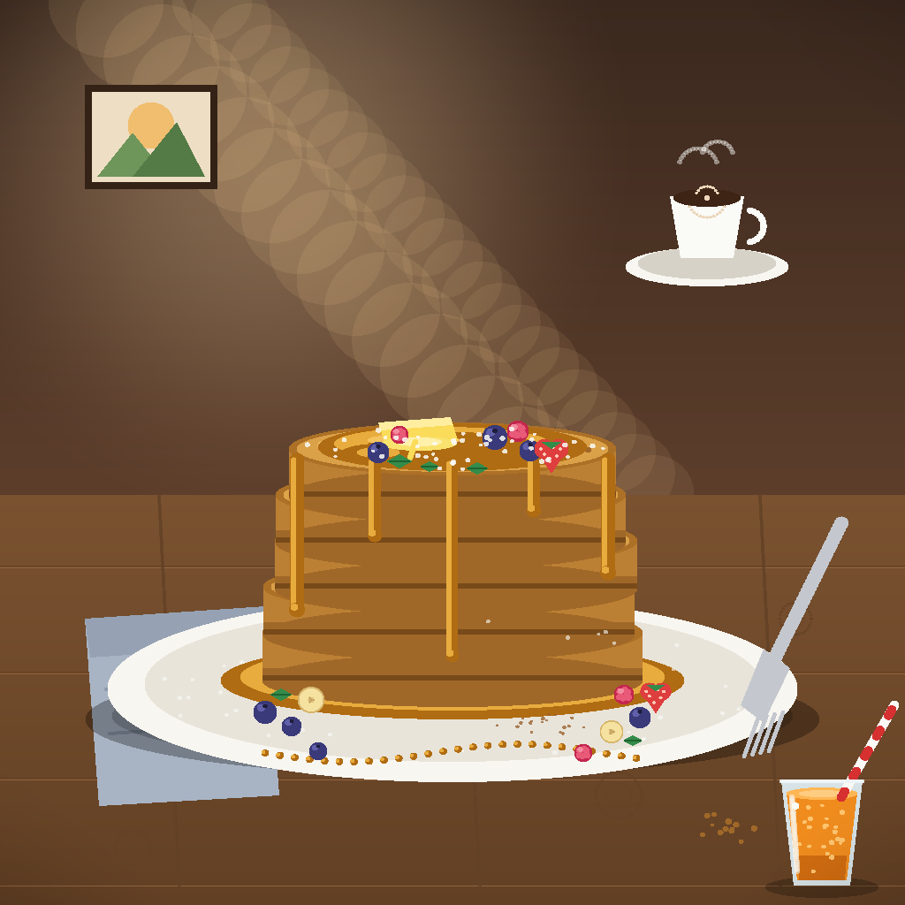

# Maple Morning — the best-looking food picture

Entry for the make.fun bounty **"Make the best-looking food picture"**
(`food-picture-01`, $250, 100 paid places).

## The picture

One original 1024×1024 picture, drawn entirely procedurally by `main.py`
with the Python standard library only: a tall stack of golden pancakes on
a white ceramic plate, maple syrup poured over the top and dripping down
the sides, a pat of melting butter, fresh blueberries, strawberries and
mint, a dusting of powdered sugar — on a warm wooden table in soft
morning light, with a cup of coffee, a glass of fresh orange juice,
a fork and a folded napkin beside it. Warm colour, glossy syrup, visible texture: built to make a viewer
hungry at one look, and to still read as one delicious dish at ~300
pixels across.



## Run it

```sh
mkdir -p out && MAKEFUN_OUTPUT_DIR=out python3 main.py
```

Writes `entry.png` into `$MAKEFUN_OUTPUT_DIR` (or `/output` when the
variable is not set). No network, no external assets, no randomness that
is not seeded (`SEED = 20261113`): every run writes the same bytes, so
the two sandbox runs the bounty requires produce identical files.

The PNG is encoded by hand with `zlib` (colour type 2, 8-bit RGB,
per-row filter choice), so the program needs nothing beyond the standard
library: `hashlib`, `math`, `os`, `random`, `struct`, `sys`, `zlib`.

## Verification

- Two fresh runs produce byte-identical output
  (sha256 `6cee1aff29aceb5d850519daba43a05be40730ada4bf25d29b9ae7e273b4a884`)
- Output: valid PNG, 1024×1024, 108,818 bytes (limit: 1 MiB, 1024×1024)
- Runtime: ~2.8 s per run (limit: 60 s)

## License

MIT — see [LICENSE](LICENSE).
